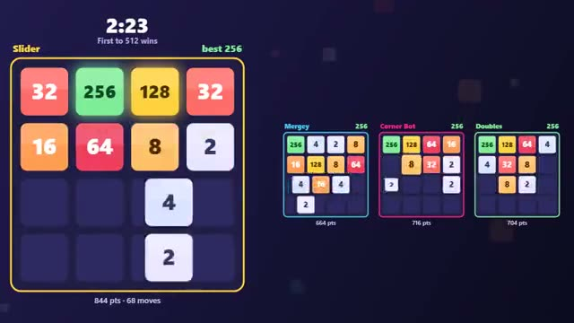

# Merge Race

Same tiles for everyone. First to 512 wins. A multiplayer starter game from [Multiplayer Agent](https://multiplayeragent.com): 2D, versus, 2–4 players, with bots that fill empty seats.

## How it plays

Slide every tile at once; two equal numbers merge into their sum. Everyone starts from the same board and gets the same new tiles in the same order, so the race is pure skill. First to 512 wins, or the best tile when the 2:30 clock runs out.

**Controls:** Arrow keys or WASD, or swipe (drag with the mouse).

## Make it yours in the Game Builder

Open the [Game Builder](https://multiplayeragent.com), choose **Start from a starter game** and pick Merge Race. It opens as version 1 in your studio, ready to play and publish. Then ask for changes, for example:

- Make the target 2048 with a 5-minute clock
- Add a power-up that swaps two tiles
- Turn the numbers into fruit that grow when they merge

## Run it yourself

1. Get a free publishable key (`pk_…`) at [multiplayeragent.com](https://multiplayeragent.com).
2. In `index.html`, put it in place of `pk_REPLACE_ME` in the `MP_CONNECT` block.
3. Open `index.html` in a browser. No build step and no server needed.

Without a key it still runs, offline against bots.

## How it is built

- One `index.html`. The comment at the top of the script maps the code and explains the multiplayer.
- Every tile and effect is drawn in code on a canvas; there are no image files.
- New tiles come from a seeded random generator, so every board in a race starts the same and draws the same numbers in the same order.
- A stuck board (no move left) sheds its smallest tiles after a moment, so nobody sits out the rest of the race.
- **Live sync:** Every rival's board slides next to yours, move by move.
- **Host-run rounds:** The host's browser runs the race: the clock, who reached 512 first and the restart. If it leaves, the next player takes over.
- **Bots:** Bots fill empty seats and race you with a corner strategy.
- **Leaderboard:** Each player's best race score.
- `?attract` runs it offline with bots only, from a board that is close to 512. The preview video is recorded from it.

## License

MIT.
